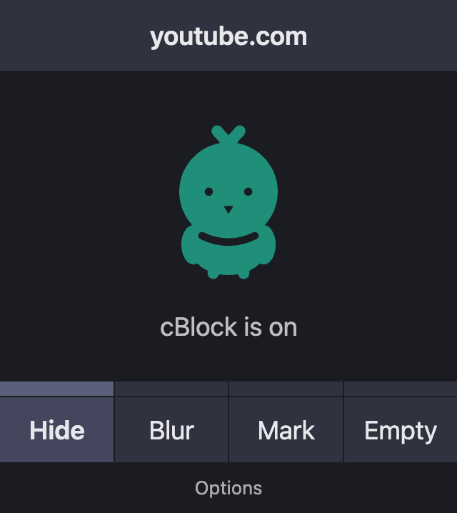

# cBlock

cBlock is a browser extension that hides Chinese content on any website.

## Install

| Chrome                                                                    | Firefox                                                            |
| ------------------------------------------------------------------------- | ------------------------------------------------------------------ |
| [![Available in the Chrome Web Store][cws-img]{width=198 height=60}][cws] | [![Get the add-on for Firefox][amo-img]{width=172 height=60}][amo] |

[cws]: https://chromewebstore.google.com/detail/oondbgdckgnijklignemhffjlkioodgp
[cws-img]: /images/chrome-web-store.png
[amo]: https://addons.mozilla.org/firefox/addon/cblock/
[amo-img]: /images/firefox-add-ons.png

## Permissions

| Permission                  | Use                                                         |
| --------------------------- | ----------------------------------------------------------- |
| `storage`                   | Stores cBlock’s settings and the results of website lookups |
| `activeTab`                 | Lets the popup find the current tab and its website         |
| `declarativeNetRequest`     | Blocks access to China-linked websites                      |
| `http://*/*`, `https://*/*` | Finds and hides Chinese content on all websites             |

## How cBlock works

cBlock uses the four methods below to hide Chinese content and block connections to [China-linked websites](#what-to-hide). For details, see [How cBlock Decides](./how-it-works).

| Method              | What it does                                                                                        |
| ------------------- | --------------------------------------------------------------------------------------------------- |
| **Text filter**     | Hides Chinese text and links to China-linked websites                                               |
| **Name filter**     | Hides items that mention a China-linked company or product (off by default)                         |
| **Website scripts** | Checks sellers, developers, and more that text alone can’t tell, website by website, and hides them |
| **Domain block**    | Blocks China-linked websites before they load                                                       |

## Popup



| Item                         | What it does                                                                             |
| ---------------------------- | ---------------------------------------------------------------------------------------- |
| **Website name**             | The website in the current tab                                                           |
| **On/off switch**            | Turns cBlock on or off for this website. Shift-click turns it on or off for all websites |
| **Status**                   | Shows whether cBlock is on or off, or not available on this page                         |
| **Default for all websites** | The mode used on all websites                                                            |
| **Mode for this website**    | The mode used only on this website. Click it again to go back to the default             |
| **Options**                  | Opens the Options page                                                                   |

## Options

| Item                                          | What it does                                                            |
| --------------------------------------------- | ----------------------------------------------------------------------- |
| **Turn on cBlock**                            | Turns cBlock on or off for all websites                                 |
| **Show the hidden count on the toolbar icon** | Shows on the toolbar icon how many items were hidden in the current tab |

### Default mode

| Item      | How blocked items look                                                    |
| --------- | ------------------------------------------------------------------------- |
| **Hide**  | Items are not shown                                                       |
| **Blur**  | Items are shown blurred (default)                                         |
| **Mark**  | Items are outlined with a dashed line and stay usable                     |
| **Empty** | Items are hidden, but their space stays blank so the layout doesn’t break |

### What to hide

| Item                                             | What it does                                                                |
| ------------------------------------------------ | --------------------------------------------------------------------------- |
| **Chinese text**                                 | Hides posts, articles, and other items with Chinese text                    |
| └ **Show Traditional Chinese**                   | Hides only Simplified Chinese                                               |
| **Names of China-linked companies and products** | Hides items that mention a China-linked company or product (off by default) |
| └ Each genre                                     | The genres to hide                                                          |
| └ **Toggle All**                                 | Turns all genres on or off                                                  |
| **Block pages of China-linked websites**         | Blocks China-linked websites before they load                               |
| **Links to China-linked websites**               | Hides links to China-linked websites                                        |

> China-linked websites are websites of companies founded or based in China, and websites whose domain ends in `.cn`, `.中国`, or `.中國`.

### Website lookups

- All are off by default.
- When turned on, cBlock asks the website you’re on about sellers, developers, authors, and more, to tell more accurately whether they’re based in China.
- See the [Privacy Policy](./privacy-policy#website-lookups) for details.
- The X and pixiv lookups use private APIs, so the website may restrict your account. Use them at your own risk.

| Website    | What cBlock asks                                | What it hides                      |
| ---------- | ----------------------------------------------- | ---------------------------------- |
| **Amazon** | Seller’s address, phone, and name               | Products by sellers based in China |
| **Steam**  | Game’s developer and publisher                  | Games by studios based in China    |
| **X**      | Author’s account location and connection source | Posts by accounts based in China   |
| **pixiv**  | Artist’s profile                                | Works by artists based in China    |

### Mode per website

- You can set a mode per website. Enter one website and mode per line.
- Set the mode to one of these four:
    - `hide`
    - `blur`
    - `mark`
    - `empty`
- Websites not in the list use the default mode.

```text
youtube.com hide
news.yahoo.co.jp blur
news.example.com mark
```

> cBlock runs on a listed website even if it is turned off on the parent domain. The more specific domain wins, so in the example above, `news.example.com` runs with `mark` even if `example.com` is in [Websites to turn off](#websites-to-turn-off) below.

### Websites to turn off

Enter one website per line where cBlock should not run. In the example below, `www.example.com` is turned off too.

```text
example.com
```
