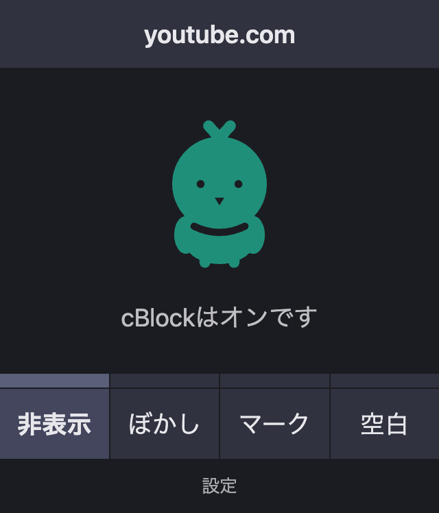

# cBlock

cBlockはあらゆるWebサイトで中国語・中国系のコンテンツを非表示にするブラウザ拡張機能です。

## インストール

| Chrome                                                            | Firefox                                                        |
| ----------------------------------------------------------------- | -------------------------------------------------------------- |
| [![Chrome ウェブストアで入手][cws-img]{width=198 height=60}][cws] | [![Firefox アドオンを入手][amo-img]{width=172 height=60}][amo] |

[cws]: https://chromewebstore.google.com/detail/oondbgdckgnijklignemhffjlkioodgp
[cws-img]: /images/chrome-web-store.png
[amo]: https://addons.mozilla.org/firefox/addon/cblock/
[amo-img]: /images/firefox-add-ons.png

## 必要な権限

| 権限                        | 用途                                                                  |
| --------------------------- | --------------------------------------------------------------------- |
| `storage`                   | cBlockの設定とWebサイトへの問い合わせの結果を保存します               |
| `activeTab`                 | ポップアップが現在のタブとそのWebサイトを調べられるようにします       |
| `declarativeNetRequest`     | 中国系Webサイトへのアクセスをブロックします                           |
| `http://*/*`、`https://*/*` | すべてのWebサイトで中国語・中国系のコンテンツを見つけて非表示にします |

## cBlockのしくみ

次の4つのしくみで中国語・中国系のコンテンツを非表示にし、[中国系Webサイト](#非表示にするもの)への接続をブロックします。詳しくは[判定のしくみ](./how-it-works)をご覧ください。

| しくみ                    | 内容                                                                              |
| ------------------------- | --------------------------------------------------------------------------------- |
| **テキストフィルター**    | 中国語のテキストと中国系Webサイトへのリンクを非表示にします                       |
| **名称フィルター**        | 中国系の企業や製品の名前が出てくる項目を非表示にします（初期設定ではオフ）        |
| **Webサイト別スクリプト** | テキストだけではわからない出品者や開発元などをWebサイトごとに調べて非表示にします |
| **ドメインブロック**      | 中国系Webサイトを読み込む前にブロックします                                       |

## ポップアップ



| 項目                              | 内容                                                                                                                            |
| --------------------------------- | ------------------------------------------------------------------------------------------------------------------------------- |
| **Webサイト名**                   | 現在開いているタブのWebサイト                                                                                                   |
| **オン/オフのスイッチ**           | このWebサイトでcBlockのオン/オフを切り替えます。Shiftキーを押しながらクリックすると、すべてのWebサイトでオン/オフを切り替えます |
| **状態**                          | cBlockがオンかオフか、またはこのページで利用できないことを表示します                                                            |
| **すべてのWebサイトのデフォルト** | すべてのWebサイトに適用される表示方法                                                                                           |
| **Webサイトごとの表示方法**       | このWebサイトだけに適用される表示方法。再度クリックでデフォルトに戻ります                                                       |
| **設定**                          | 設定ページを開くボタン                                                                                                          |

## 設定

| 項目                                         | 内容                                                         |
| -------------------------------------------- | ------------------------------------------------------------ |
| **cBlockをオンにする**                       | すべてのWebサイトでcBlockを使うかどうかを切り替えます        |
| **非表示にした数をツールバーアイコンに表示** | 現在のタブで非表示にした数をツールバーのアイコンに表示します |

### デフォルトの表示方法

| 項目       | ブロックした項目の表示方法                                                   |
| ---------- | ---------------------------------------------------------------------------- |
| **非表示** | 項目を表示しません                                                           |
| **ぼかし** | 項目をぼかして表示します（初期設定）                                         |
| **マーク** | 項目を点線の枠で囲み、操作可能な状態のまま表示します                         |
| **空白**   | 項目を非表示にしますが、レイアウトを崩さないよう元の場所を空白のまま残します |

### 非表示にするもの

| 項目                                  | 内容                                                                       |
| ------------------------------------- | -------------------------------------------------------------------------- |
| **中国語のテキスト**                  | 中国語のテキストを含む投稿や記事などを非表示にします                       |
| └ **繁体字の中国語を表示**            | 簡体字だけを非表示にします                                                 |
| **中国系の企業や製品の名前**          | 中国系の企業や製品の名前が出てくる項目を非表示にします（初期設定ではオフ） |
| └ 各ジャンル                          | 非表示にするジャンルです                                                   |
| └ **すべて切り替え**                  | すべてのジャンルのオン/オフを切り替えます                                  |
| **中国系Webサイトのページをブロック** | 中国系Webサイトを読み込む前にブロックします                                |
| **中国系Webサイトへのリンク**         | 中国系Webサイトへのリンクを非表示にします                                  |

> 中国系Webサイトとは、中国で創業した企業や中国を拠点とする企業のWebサイトと `.cn`、`.中国`、または `.中國` ドメインのWebサイトです。

### Webサイトへの問い合わせ

- 初期設定ではすべてオフです。
- オンにすると、出品者、開発元、投稿者などについて表示中のWebサイトに問い合わせ、中国を拠点としているかどうかをより正確に判定します。
- 詳細は[プライバシーポリシー](./privacy-policy#webサイトへの問い合わせ)をご覧ください。
- Xとpixivは非公開のAPIを使用するため、アカウントが制限される場合があります。自己責任でご利用ください。

| Webサイト  | 問い合わせる内容                   | 非表示にするもの                   |
| ---------- | ---------------------------------- | ---------------------------------- |
| **Amazon** | 出品者の住所、電話番号、および名前 | 中国を拠点とする出品者の商品       |
| **Steam**  | ゲームの開発元とパブリッシャー     | 中国を拠点とするスタジオのゲーム   |
| **X**      | 投稿者のアカウントの所在地と接続元 | 中国を拠点とするアカウントのポスト |
| **pixiv**  | 作者のプロフィール                 | 中国を拠点とする作者の作品         |

### Webサイトごとの表示方法

- Webサイトごとに表示方法を決められます。1行に1つずつWebサイトと表示方法を入力します。
- 表示方法を次の4つのいずれかに設定します。
    - `hide`（非表示）
    - `blur`（ぼかし）
    - `mark`（マーク）
    - `empty`（空白）
- 一覧にないWebサイトはデフォルトの表示方法を使います。

```text
youtube.com hide
news.yahoo.co.jp blur
news.example.com mark
```

> 一覧のWebサイトでは親ドメインでcBlockをオフにしていてもcBlockが動作します。下位ドメインの指定が優先されるので、上の入力例では後述の[オフにするWebサイト](#オフにするwebサイト)に `example.com` があっても、`news.example.com` では `mark` で動作します。

### オフにするWebサイト

cBlockを使わないWebサイトを1行に1つずつ入力します。下の入力例では `www.example.com` でもオフになります。

```text
example.com
```
